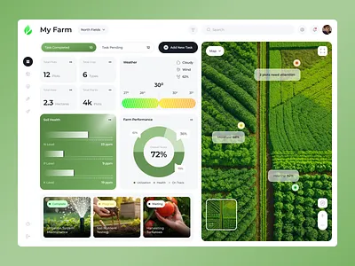
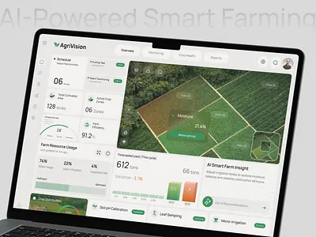

# GrainClaim look and feel

_Last updated: November 10, 2026._

Clean and calm: white cards, green for the farm, yellow only where something needs attention. This goes with `docs/spec.md` Part 11 (UI principles) and the farmer rules in `AGENTS.md`. For the hackathon, design for a laptop browser.

Every screen prompt should say "Follow docs/spec.md Part 11 and docs/design.md."

## Reference screens

Two screens are inspiration for layout and feel, not a design to copy.



Reference 1: the map on the right with floating field labels, and the white cards on a light page.



Reference 2: outlined fields over satellite imagery, and big numbers with small labels.

## Take from them

- **Map first.** The satellite farm map fills the right side. Fields are translucent green outlines with small floating labels (field name, acres, "2 tickets need a look").
- **Quiet chrome.** A thin icon rail on the left and one top bar (farm name, role switcher). Nothing else around the edges.
- **A few big numbers.** Unit 1 and Unit 2 bushels against the guarantee, loads today. Big figure, small label.
- **Space.** Rounded white cards on a very light green-gray page, soft shadows, generous padding.

## Leave out

- Weather, soil health, donut charts, resource usage and "AI insight" cards. None of it is in GrainClaim.
- Modals without a reason. Use one only to confirm a step that can't be undone (approving the report, mixing grain anyway). Everything else opens inline or in a side panel next to the map.
- More than one main button per screen, decorative icons and gradients.

## Colors

| Token | Hex | Use |
|---|---|---|
| Page | #F6F8F4 | Background behind the cards |
| Card | #FFFFFF | Cards, panels, the top bar |
| Ink | #1E2A21 | Main text |
| Muted ink | #5F6B62 | Labels, secondary text |
| Line | #DFE6DA | Card edges, dividers, the borders of the top bar and icon rail |
| Green 700 | #2F6B3A | Main buttons, active nav; white text sits on it |
| Green 500 | #5A9E4B | Field outlines, progress bars |
| Green 100 | #E7F1E1 | Field fill, selected rows, chips |
| Yellow 400 | #F2C94C | Needs attention and warnings, as a fill with dark text (never yellow text) |
| Yellow 100 | #FDF5D8 | Background of an item that needs attention |

```css
:root {
  --page: #F6F8F4;
  --card: #FFFFFF;
  --ink: #1E2A21;
  --ink-muted: #5F6B62;
  --line: #DFE6DA;
  --green-700: #2F6B3A;
  --green-500: #5A9E4B;
  --green-100: #E7F1E1;
  --yellow-400: #F2C94C;
  --yellow-100: #FDF5D8;
}
```

These are set up in `app/globals.css` as theme tokens, so screens use class names (`bg-page`, `text-ink`, `text-ink-muted`, `border-line`, `bg-green-700`, `bg-yellow-100`) and never a hex value.

## Fonts

- **Bricolage Grotesque** for headings and the big numbers.
- **Instrument Sans** for everything else.

Both are free on Google Fonts and load with `next/font/google`. They avoid the usual Inter, Roboto and Poppins look, and Bricolage has a slightly hand-made feel that suits a farm without looking rustic. Use tabular numbers (`font-variant-numeric: tabular-nums`) for bushels and acres so columns line up.
